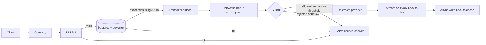

# SmartRoute Core

An OpenAI compatible gateway written in Go that sits in front of an LLM provider and answers repeated questions from a cache instead of paying for them again.

It checks three things before it calls the provider: an exact match (SHA 256 over the normalised request), a semantic match (pgvector HNSW search over prompt embeddings), and a guard that rejects near duplicates that differ in the details that matter, such as "France" versus "Germany".

> **Status: first pass, written without a Go compiler.** The code was written and hand reviewed in an environment with no Go toolchain, Docker, Postgres or network, so **it has not been compiled or run yet**. The Python parts (embedding sidecar, benchmark harness, guard port) were executed and tested. Your first step is `go build ./... && go test -race ./...`; see [First steps](#first-steps). No performance numbers are claimed anywhere in this repository: [docs/BENCHMARKS.md](docs/BENCHMARKS.md) describes how to produce them.

## What works today (core milestone)

| Capability | Notes |
|---|---|
| OpenAI compatible `POST /v1/chat/completions` | Point any OpenAI client at it by changing the base URL. Request bytes are forwarded untouched |
| Exact cache | In process LRU (L1) in front of Postgres, keyed by tenant, model, system prompt, parameters and conversation |
| Semantic cache | Single turn prompts only, cosine similarity through pgvector HNSW, top K candidates, tunable threshold |
| False positive guard | Rejects hits that differ in numbers, negation, known antonyms or capitalised names |
| Streaming | Misses are streamed through as they arrive and recorded for the cache. Hits are replayed as a stream. A streamed answer can satisfy a non streamed request and the reverse |
| Request coalescing | Identical concurrent non streaming requests share one upstream call |
| Graceful degradation | A dead embedder or database turns lookups into misses; requests keep working |
| Observability | Prometheus text metrics at `/metrics`, per stage `Server-Timing` header, per request rows in `request_log` |
| Mock upstream | Deterministic fake LLM with fixed latency and a request counter, so benchmarks and tests are reproducible |
| Cache quality benchmark | Threshold sweep with tune/test split and an adversarial hand written pair set |

Not built yet (see [docs/ROADMAP.md](docs/ROADMAP.md)): multi provider routing, failover with circuit breaker, per tenant rate limiting and API keys, Anthropic and Google adapters.

## Architecture



## First steps

```powershell
# 1. Make the module path yours (once), then resolve dependencies and commit go.sum
python scripts/rename_module.py github.com/<your-github-user>/smartroute-core
go mod tidy

# 2. Compile and test. This is the first time this code meets a compiler: expect to fix a few things.
go build ./...
go vet ./...
go test -race -count=1 ./...
```

If something fails, the error messages are usually one line fixes. Send them to whoever helps you maintain this and they can be fixed quickly.

## Run it

**Quick local run (no Docker).** Uses the in memory store and a fake word overlap embedder, so semantic hits are only meaningful for near identical wording.

```powershell
# terminal 1: fake LLM that answers after 500 ms
go run ./cmd/mockupstream -latency=500ms
# terminal 2: the gateway (UPSTREAM_BASE_URL defaults to http://localhost:9000)
go run ./cmd/gateway
# terminal 3: ask the same thing twice and a paraphrase
python scripts/smoke.py http://localhost:8080
```

**Full stack (Postgres + pgvector + real embedding model).**

```powershell
go mod tidy                                   # go.sum must exist for the Docker build
docker compose -f deploy/docker-compose.yml up --build
python scripts/smoke.py http://localhost:8080
```

The first build downloads PyTorch (CPU) and the embedding model, which takes a while. Set `EMBED_BACKEND=hash` in your environment for a lightweight but non semantic demo.

**Use a real provider.** Set `UPSTREAM_BASE_URL=https://api.openai.com` and `UPSTREAM_API_KEY=...`, and supply prices for the cost estimate through `PRICES_JSON` (see `.env.example`). Never commit keys.

## Using it from a client

```python
from openai import OpenAI
client = OpenAI(base_url="http://localhost:8080/v1", api_key="anything-or-your-GATEWAY_API_KEY",
                default_headers={"X-SmartRoute-Tenant": "my-team"})
resp = client.chat.completions.create(model="mock-llm", messages=[{"role": "user", "content": "How do I reset my password?"}])
```

Response headers tell you what happened:

| Header | Values |
|---|---|
| `X-SmartRoute-Cache` | `hit-l1`, `hit-exact`, `hit-semantic`, `miss`, `coalesced`, `bypass`, `skip` (not cacheable), `disabled` |
| `X-SmartRoute-Similarity` | cosine similarity, on semantic hits |
| `Server-Timing` | per stage milliseconds (non streaming): `hash`, `l1`, `exact`, `embed`, `vector`, `guard`, `upstream` |
| `X-Request-Id` | echoed or generated |

Send `X-SmartRoute-Cache: bypass` to skip the cache for one request (it neither reads nor writes).

> **Security note.** `X-SmartRoute-Tenant` is trusted as sent. That is fine for a demo and **not acceptable in production**: tenants must be derived from authenticated API keys, which is the first item of the next milestone. Until then, run the gateway only in front of clients you control. Cached prompts and answers are stored in plain text in Postgres.

## Configuration

All settings are environment variables (see `.env.example`). The ones you will touch:

| Variable | Default | Meaning |
|---|---|---|
| `UPSTREAM_BASE_URL` | `http://localhost:9000` | OpenAI compatible server, without `/v1` |
| `DATABASE_URL` | empty | Postgres URL; empty means in memory store |
| `EMBEDDER_URL` | empty | Sidecar URL; empty means fake hash embedder |
| `SEMANTIC_THRESHOLD` | `0.92` | Minimum cosine similarity. **A placeholder: tune it with the benchmark** |
| `SEMANTIC_MAX_CHARS` | `1000` | Longer prompts use exact match only |
| `GUARD_ENABLED` | `true` | Reject hits that differ in numbers, negation, antonyms or names |
| `CACHE_TTL` | `24h` | Entry lifetime |
| `GATEWAY_API_KEY` | empty | If set, clients must send it as a Bearer token |
| `HNSW_EF_SEARCH` | `40` | Recall versus speed of the vector search |

## Measuring it

Nothing here is benchmarked yet. The plan, commands and the metrics each run produces are in [docs/BENCHMARKS.md](docs/BENCHMARKS.md). In short:

```powershell
# cache quality: hit rate versus wrong answer rate (needs: pip install sentence-transformers numpy matplotlib)
python bench/cache_quality/sweep.py --pairs bench/cache_quality/data/handwritten_pairs.csv --backend sentence-transformers --out bench/results/cache_quality
# gateway overhead (needs k6): direct to the mock, then through the gateway, then compare
k6 run -e BASE_URL=http://localhost:9000 -e MODE=miss --summary-export=bench/results/direct.json  bench/k6/overhead.js
k6 run -e BASE_URL=http://localhost:8080 -e MODE=miss --summary-export=bench/results/gateway.json bench/k6/overhead.js
python bench/overhead_report.py bench/results/direct.json bench/results/gateway.json
```

## Repository layout

```
cmd/gateway/            the gateway binary
cmd/mockupstream/       deterministic fake LLM for tests and benchmarks
internal/api/           HTTP handlers, middleware, request lifecycle
internal/cache/         L1 LRU, exact + semantic lookup, guard, in memory store
internal/store/         PostgreSQL + pgvector store, schema, request log
internal/chat/          request parsing, cache keys, completion model, SSE replay
internal/embed/         embedder interface, sidecar client, offline hash embedder
internal/provider/      OpenAI compatible upstream adapter (plain net/http)
internal/telemetry/     Prometheus text metrics, price table, request records
internal/{config,async,flight,mockllm}/
sidecar/embedder/       Python FastAPI service around a local sentence embedding model
bench/                  cache quality sweep, k6 overhead test, overhead report
deploy/                 Dockerfile and docker compose
docs/                   DESIGN, DECISIONS, BENCHMARKS, ROADMAP
scripts/                smoke test, module rename, static checker used when no Go toolchain is available
```

## Known limitations

* Not yet compiled or run (see the status note). Treat everything as unverified until `go test -race ./...` passes on your machine.
* The guard is deliberately conservative but blind to lower case names, synonyms and paraphrased negation. The benchmark keeps such cases (`guard_blind`) in the data so the limit is measured, not hidden.
* Semantic caching applies to single turn prompts only. Multi turn chats use exact matching.
* Streaming requests are not coalesced (only non streaming ones are).
* Token counts for streamed answers are estimated (about 4 characters per token) unless the provider sends usage.
* Tenant identity is a trusted header until the auth milestone.
* The semantic search uses a namespace filter together with the HNSW index. Check recall against exact search at your data size (benchmark plan, section on ANN accuracy).

## Why this exists

Production LLM traffic repeats itself, and a cache that answers the repeats can cut cost and latency. The hard part is not the cache, it is knowing when a cached answer is safe to serve. This project is built around measuring that: a threshold sweep, an explicit false positive guard and honest reporting of where it fails. Related projects worth knowing: LiteLLM, Portkey, Helicone, GPTCache and Cloudflare AI Gateway.

## License

MIT, see [LICENSE](LICENSE). Replace the copyright holder with your name.
